# LLM 长期记忆构建

::: tip
转载自掘金 · 作者：小小小小宇 · [原文链接](https://juejin.cn/post/7653601975863296054)
:::

## 一、为什么 LLM 需要长期记忆

大语言模型本身并不会天然记住你每一次对话。一次对话结束、上下文窗口被截断、换了一台电脑、换了一个客户端，模型通常就失去了之前的细节。所谓“让 LLM 记得之前”，不是让模型参数实时改变，而是在模型外部建立一套可持久化、可检索、可更新、可迁移的记忆系统。

长期记忆的目标是：当用户切换电脑、切换会话、切换设备时，LLM 仍然可以恢复重要背景，例如用户偏好、项目目标、常用工作流、长期任务、业务约束、历史决策和外部资源位置。

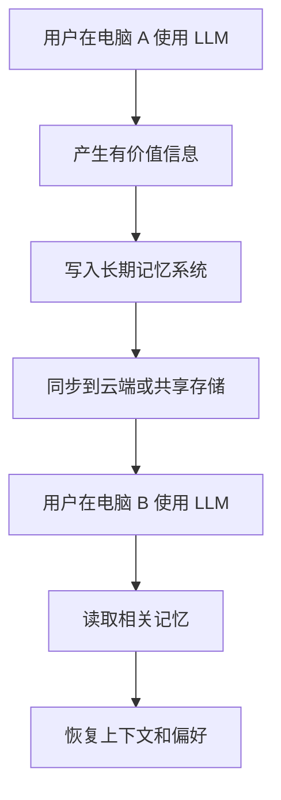

长期记忆不是简单保存聊天记录。聊天记录很长、噪声很多、难以直接使用；长期记忆应该是从历史交互中提炼出的结构化知识。

## 二、长期记忆要解决的问题

构建 LLM 长期记忆，本质上是在解决五个问题：

- 存什么：哪些信息值得长期保存。
- 怎么存：用文件、数据库、向量库、知识图谱还是混合结构。
- 怎么取：如何在新任务中找到相关记忆。
- 怎么更新：记忆过期、冲突、重复时如何维护。
- 怎么迁移：换电脑、换客户端、换模型时如何继续使用。

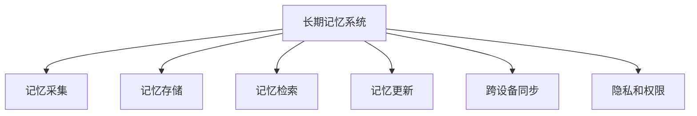

如果只保存不检索，记忆没有用；如果只检索不更新，记忆会越来越旧；如果不做隐私控制，记忆系统会变成风险源。

## 三、长期记忆和上下文窗口的区别

上下文窗口是当前对话里模型能直接看到的内容。长期记忆是存放在外部系统里的持久信息，只有在相关时才被取出放入上下文。

| 类型 | 生命周期 | 位置 | 适合内容 | 风险 |
| --- | --- | --- | --- | --- |
| 当前上下文 | 当前会话或当前请求 | Prompt 内 | 当前任务、最近消息、当前文件 | 容易超长 |
| 短期记忆 | 一段任务期间 | 会话状态或缓存 | 当前计划、临时变量、任务进度 | 会话结束丢失 |
| 长期记忆 | 跨会话、跨设备 | 文件、数据库、云端 | 偏好、项目背景、长期事实 | 过期和隐私风险 |
| 训练参数 | 模型发布周期 | 模型内部 | 通用语言和知识 | 用户不可直接更新 |

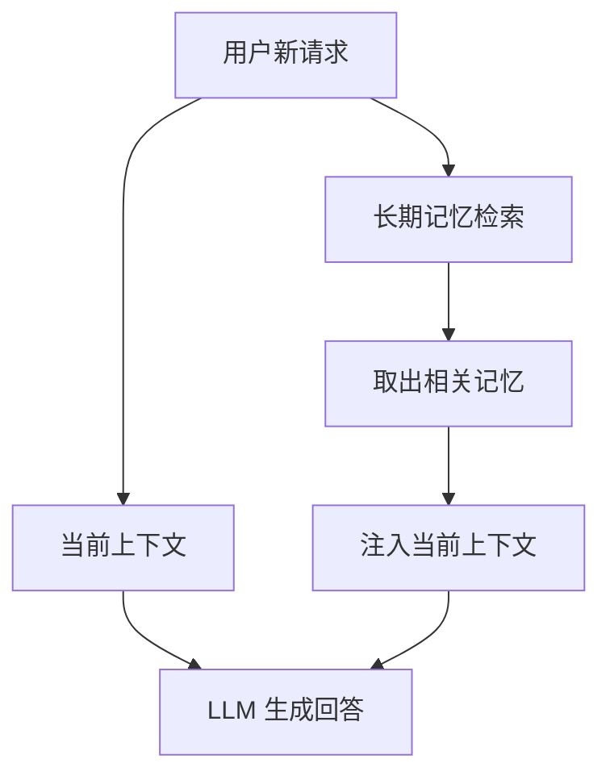

长期记忆的关键不是“全部记住”，而是“在需要时找回正确的少量信息”。

## 四、长期记忆应该记什么

一个好用的记忆系统应该优先保存对未来有帮助、相对稳定、不可从当前代码或公开文档轻易推导的信息。

适合保存：

- 用户偏好：喜欢简洁回答、喜欢中文、不要某种格式。
- 用户背景：角色、熟悉的技术栈、负责的业务领域。
- 项目背景：当前项目目标、上线约束、重要决策原因。
- 工作习惯：提 PR 前要跑哪些命令、文档命名约定。
- 外部资源：需求文档地址、监控看板、工单空间。
- 长期任务：持续推进的迁移、治理、重构目标。
- 业务约束：不能改某个接口、某功能有合规要求。

不适合保存：

- 临时调试变量。
- 一次性命令输出。
- 能从 git、代码、文档中直接查到的事实。
- 敏感密码、Token、Cookie、私钥。
- 没有未来价值的闲聊细节。
- 未确认的模型猜测。

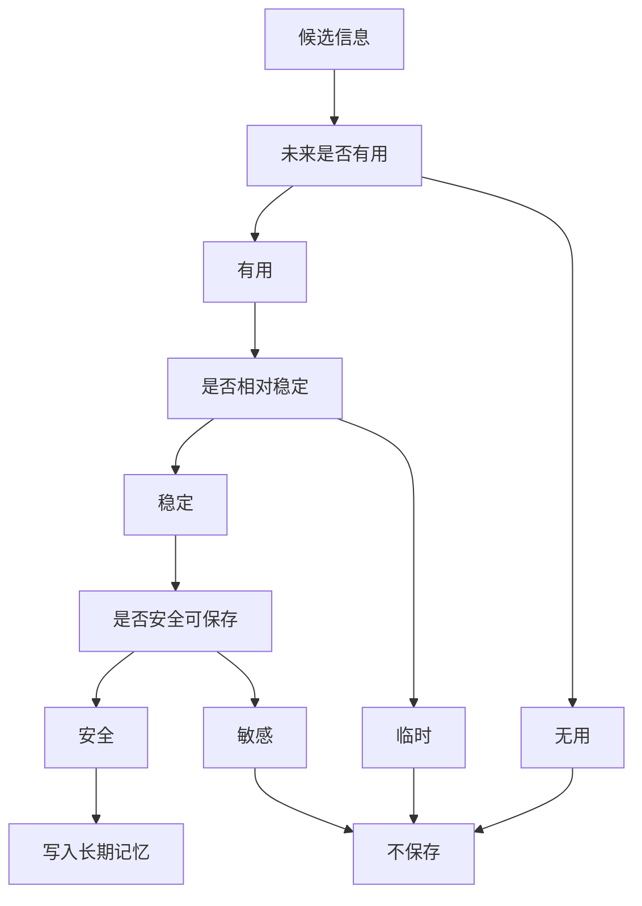

## 五、长期记忆的常见形态

### 1. 原始聊天记录

最简单的方式是保存所有聊天记录。优点是完整，缺点是噪声大、成本高、检索难、隐私风险大。

适用场景：

- 审计和回放。
- 问题追踪。
- 从历史中离线提炼记忆。

不适合直接作为主记忆层。

### 2. 摘要记忆

把一段对话总结成较短摘要，保存用户偏好、项目背景、已完成事项和待办事项。

优点是压缩率高，缺点是摘要可能丢信息或引入误解。

### 3. 结构化记忆

用固定字段保存记忆，例如类型、标题、内容、来源、更新时间、置信度、适用范围。

```json
{
  "type": "preference",
  "title": "回答语言偏好",
  "content": "用户在该工作区偏好使用中文回答技术文档生成任务。",
  "scope": "workspace:/project-a",
  "source": "user_explicit",
  "updatedAt": "2026-06-16",
  "confidence": 0.95
}
```

### 4. 向量记忆

把记忆文本转成 embedding，存入向量数据库。检索时根据语义相似度召回。

适合模糊搜索和语义相关性召回，但需要配合结构化过滤，避免召回不相关或过期信息。

### 5. 知识图谱记忆

把人、项目、系统、文档、决策、任务之间的关系建成图。

适合复杂组织知识和实体关系，例如“某个服务归属谁”“某个模块依赖哪个系统”。

### 6. 文件型记忆

把记忆写成 Markdown、JSON、YAML 等文件，通过 Git 或云盘同步。优点是简单、透明、可迁移，适合程序员个人使用。

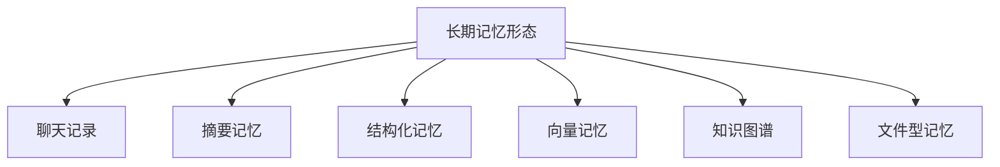

## 六、推荐架构：结构化记忆加语义检索

比较实用的长期记忆架构是：结构化存储作为事实来源，向量检索作为召回方式，摘要作为上下文压缩，人工确认作为质量控制。

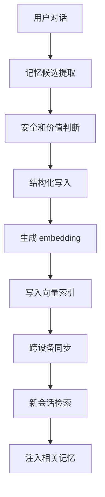

这个架构有几个好处：

- 结构化字段方便过滤和治理。
- 向量索引方便语义召回。
- 原始记忆文件方便人工查看和迁移。
- 摘要可以控制上下文长度。
- 同步层可以支持换电脑继续使用。

## 七、记忆的数据模型

一个长期记忆条目建议至少包含以下字段：

| 字段 | 说明 |
| --- | --- |
| id | 唯一标识 |
| type | 记忆类型，例如 user、project、preference、reference |
| title | 简短标题 |
| content | 记忆正文 |
| scope | 适用范围，例如全局、某工作区、某项目 |
| source | 来源，例如用户明确要求、对话推断、文档导入 |
| confidence | 置信度 |
| createdAt | 创建时间 |
| updatedAt | 更新时间 |
| expiresAt | 可选过期时间 |
| tags | 标签 |
| sensitivity | 敏感级别 |

示例：

```json
{
  "id": "mem_001",
  "type": "preference",
  "title": "Mermaid 兼容性偏好",
  "content": "用户生成 Markdown 文档时要求 Mermaid 使用 flowchart 和单向连线，避免 旧版分组语法和双向连线。",
  "scope": "workspace:vue_01",
  "source": "user_explicit",
  "confidence": 1,
  "createdAt": "2026-06-16T10:00:00Z",
  "updatedAt": "2026-06-16T10:00:00Z",
  "tags": ["markdown", "mermaid", "preference"],
  "sensitivity": "low"
}
```

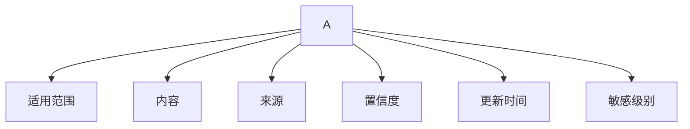

## 八、记忆类型设计

长期记忆最好按类型管理，不同类型有不同更新策略。

| 类型 | 内容 | 更新策略 |
| --- | --- | --- |
| user | 用户角色、技术背景、沟通偏好 | 用户明确表达时更新 |
| preference | 输出格式、协作方式、禁用行为 | 优先遵守，冲突时询问 |
| project | 项目目标、业务约束、阶段性背景 | 容易过期，需要时间戳 |
| reference | 外部资源地址、知识库、监控看板 | 需要定期验证 |
| workflow | 常用命令、流程、检查清单 | 结合项目变化更新 |
| decision | 历史决策和原因 | 保留原因，避免只存结论 |
| relationship | 人、系统、模块之间关系 | 适合图结构 |

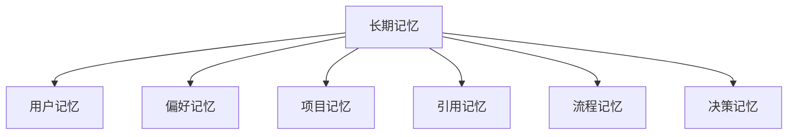

例如“用户喜欢中文回答”属于 preference；“本项目最近在做支付重构”属于 project；“接口文档在某个 wiki”属于 reference。

## 九、如何自动提取记忆候选

每轮对话结束后，可以让一个记忆提取器从对话中找出值得保存的信息。它不应该把所有内容都保存，而是先生成候选，再经过规则或用户确认。

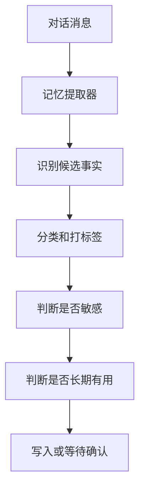

提取提示词可以这样设计：

```text
请从这段对话中提取值得长期保存的记忆候选。
只保存未来有帮助、相对稳定、非敏感的信息。
不要保存临时任务状态、一次性命令输出、可从代码直接查到的事实。
输出 JSON 数组，每项包含 type、title、content、scope、source、confidence。
```

记忆候选仍需要校验。尤其是模型推断出的内容，不应该和用户明确表达的事实同等对待。

## 十、显式记忆和隐式记忆

长期记忆可以分为显式记忆和隐式记忆。

显式记忆是用户明确要求保存的，例如“记住我以后都想要中文回答”。这种记忆置信度高，应该立即保存。

隐式记忆是系统从行为中推断的，例如用户连续多次要求 Markdown 文档使用某种格式。隐式记忆有价值，但容易误判，最好降低置信度或请求确认。

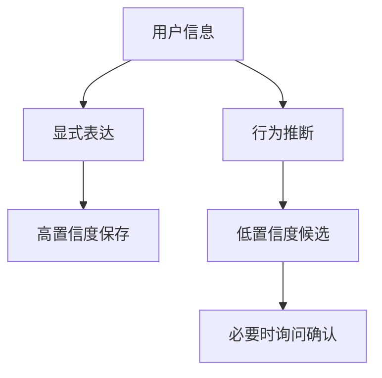

实际系统可以采用策略：

- 用户说“记住”：直接保存。
- 用户说“以后都”：优先保存为偏好。
- 用户纠正模型行为：保存为反馈记忆。
- 系统推断出的偏好：连续出现多次后再保存。
- 涉及敏感信息：默认不保存。

## 十一、如何跨电脑记住之前

要做到换电脑仍然记得，本质是让记忆存储不依赖单台设备，或者可以在设备之间同步。

常见方案：

### 1. 云端数据库

把记忆存到云端服务，例如 PostgreSQL、MongoDB、Redis、向量数据库。不同电脑登录同一账号后，从云端读取记忆。

优点：实时同步、权限好做、适合多端。缺点：需要后端服务和安全设计。

### 2. Git 同步

把记忆写成 Markdown 或 JSON 文件，放在私有 Git 仓库里。换电脑后 clone 仓库即可恢复。

优点：透明、可版本管理、程序员友好。缺点：需要处理冲突和敏感信息。

### 3. 云盘同步

使用 iCloud、Dropbox、OneDrive、坚果云等同步本地记忆文件。

优点：简单。缺点：并发冲突、权限和审计能力弱。

### 4. 客户端账号体系

AI 产品自己提供账号级记忆。用户换设备登录同一账号，记忆跟随账号。

优点：用户体验好。缺点：依赖产品能力，不一定可导出。

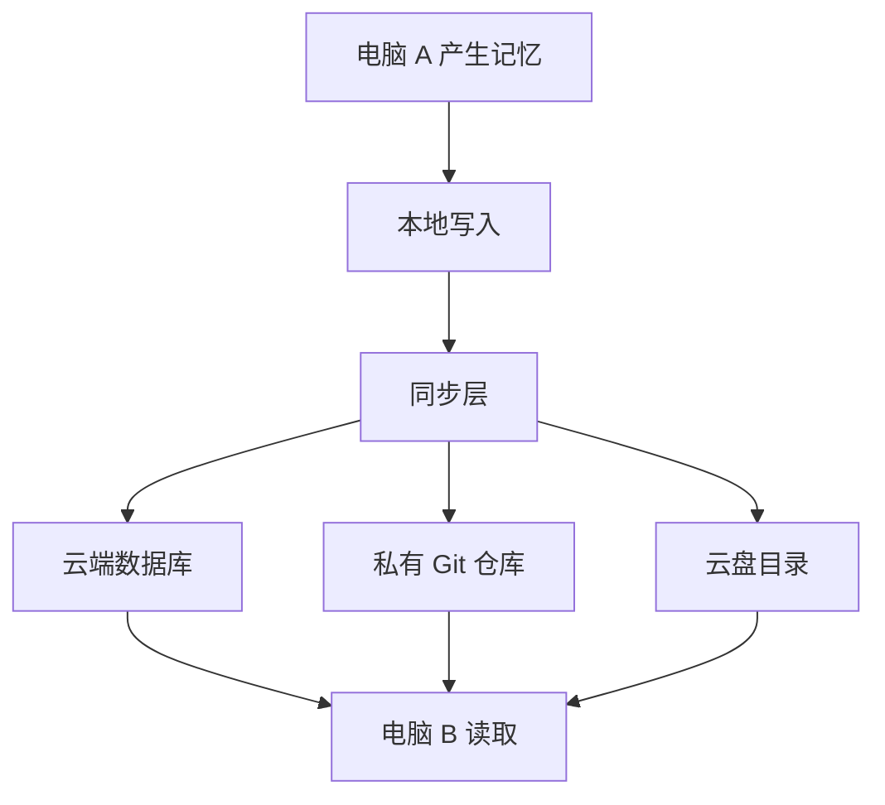

程序员个人最实用的方案通常是“文件型记忆加 Git 私有仓库”或“SQLite 加同步目录”。团队产品更适合云端数据库和账号体系。

## 十二、文件型记忆方案

文件型记忆非常适合个人开发者。每条记忆一个 Markdown 文件，配合一个索引文件。好处是可以人工阅读、编辑、审查、版本控制。

目录结构示例：

```text
memory
├── MEMORY.md
├── user_language_preference.md
├── feedback_mermaid_compatibility.md
├── project_release_policy.md
└── reference_monitor_dashboard.md
```

记忆文件示例：

```markdown
---
name: mermaid_compatibility
description: Markdown 文档中的 Mermaid 兼容性偏好
type: preference
scope: workspace:vue_01
updatedAt: 2026-06-16
---

用户生成 Markdown 文档时，要求 Mermaid 使用更通用的 flowchart 和单向连线。

原因：部分 Markdown 渲染器内置 Mermaid 版本较旧。

应用：生成流程图时避免 旧版分组语法和双向连线。
```

索引文件示例：

```markdown
# Memory Index

- [Mermaid Compatibility](feedback_mermaid_compatibility.md) — Markdown 流程图兼容性偏好。
- [Language Preference](user_language_preference.md) — 用户偏好中文技术文档。
```

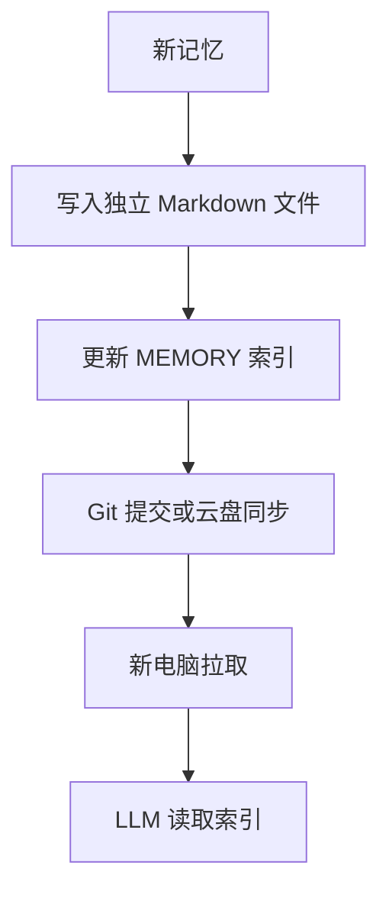

## 十三、数据库记忆方案

数据库方案更适合产品化系统。可以用关系型数据库保存结构化字段，用向量数据库保存 embedding，用对象存储保存原始资料。

表结构示例：

```sql
CREATE TABLE memories (
  id TEXT PRIMARY KEY,
  user_id TEXT NOT NULL,
  type TEXT NOT NULL,
  title TEXT NOT NULL,
  content TEXT NOT NULL,
  scope TEXT NOT NULL,
  source TEXT NOT NULL,
  confidence REAL NOT NULL,
  sensitivity TEXT NOT NULL,
  created_at TIMESTAMP NOT NULL,
  updated_at TIMESTAMP NOT NULL,
  expires_at TIMESTAMP
);
```

检索流程：

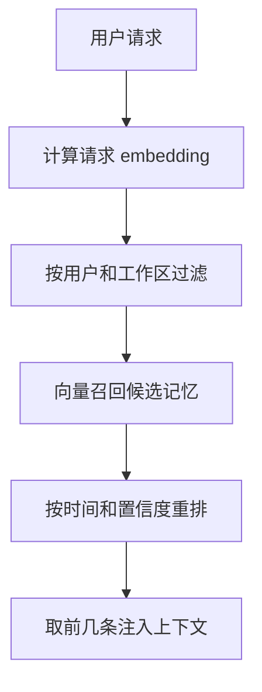

数据库方案要特别关注权限隔离，避免 A 用户检索到 B 用户的记忆。

## 十四、向量检索怎么用于长期记忆

向量检索适合处理“语义相近但文字不同”的问题。例如用户问“之前我说过文档流程图有什么限制吗”，系统应该能召回“Mermaid 兼容性偏好”。

流程如下：

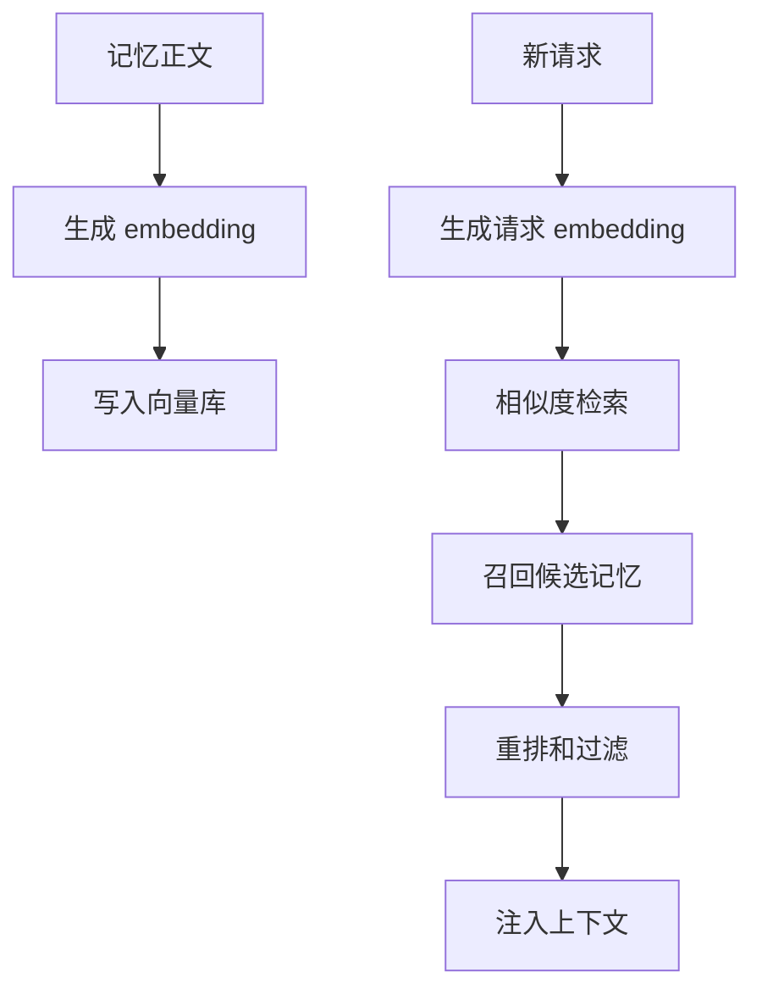

注意事项：

- 向量检索只负责召回，不负责判断事实是否仍然正确。
- 要结合 scope、type、updatedAt、confidence 过滤。
- 召回结果需要限制数量，避免污染上下文。
- 重要记忆最好同时支持关键词检索。
- 过期记忆应降权或不召回。

## 十五、记忆检索策略

一次请求来了之后，并不是所有记忆都应该注入。好的检索策略会先判断任务需要什么记忆。

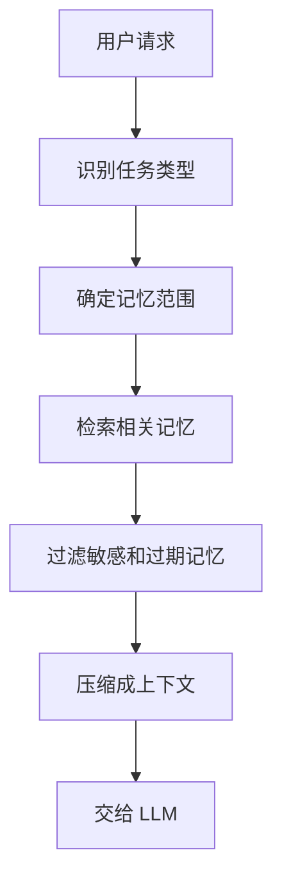

检索策略可以包含：

- 当前工作区优先于全局记忆。
- 用户明确问“记得吗”时扩大检索范围。
- 代码任务优先检索项目和偏好记忆。
- 文档任务优先检索格式偏好。
- 涉及外部资源时检索 reference 记忆。
- 已过期项目记忆默认不注入。
- 低置信度隐式记忆只作为提示，不作为事实。

## 十六、记忆注入上下文的方式

记忆被召回后，需要以清晰格式放进 Prompt，让模型知道这些是长期记忆，不是当前用户的新指令。

推荐格式：

```text
以下是可能相关的长期记忆。它们可能过期，使用前请结合当前上下文判断。

[preference][workspace:vue_01][confidence:1.0]
用户生成 Markdown 技术文章时偏好中文，并要求 Mermaid 使用 flowchart 与单向连线。

[project][workspace:payment][updated:2026-05-01][confidence:0.8]
支付重构目标是降低合规风险，不是单纯技术债清理。
```

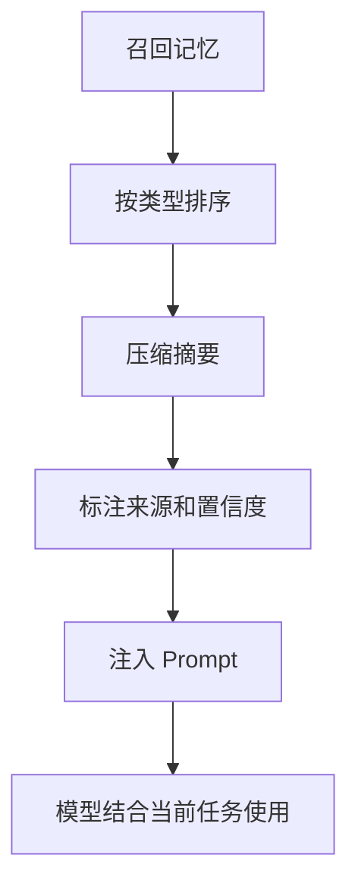

不要把记忆伪装成系统指令。用户当前明确要求应优先于历史偏好。

## 十七、记忆更新和冲突处理

长期记忆最大的难点是会过期、冲突、重复。比如用户过去喜欢英文回答，后来改成中文；项目过去使用 Jest，后来迁移到 Vitest。

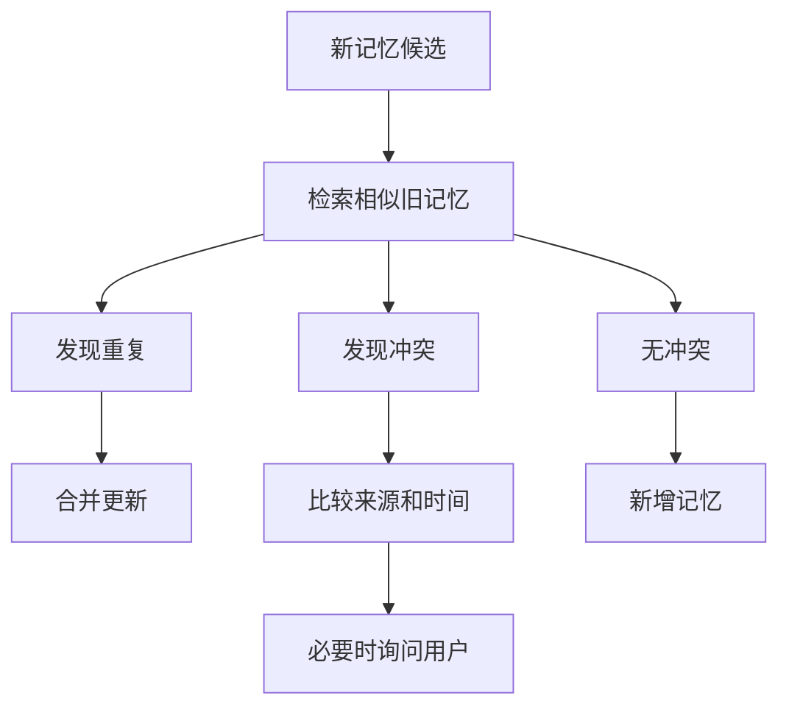

冲突处理原则：

- 用户明确新指令优先于历史记忆。
- 时间更新的事实通常优先于旧事实。
- 显式记忆优先于隐式推断。
- 当前代码和实时工具结果优先于记忆。
- 无法判断时询问用户。
- 不要静默保留互相矛盾的记忆。

记忆文件中最好保留更新时间和原因，这样未来更容易判断是否仍然有效。

## 十八、记忆遗忘机制

长期记忆系统必须支持遗忘。否则它会不断积累垃圾信息，也可能保存用户不希望保存的内容。

遗忘包括：

- 用户明确要求删除。
- 记忆超过过期时间。
- 记忆被新事实取代。
- 记忆被判断为错误。
- 记忆包含敏感信息。
- 记忆长期未被使用且价值很低。

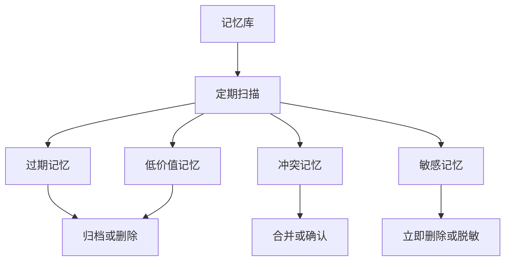

遗忘不只是删除，也可以是归档、降权、标记过期。对于重要决策，通常不应直接删除，而是标注“已被新决策替代”。

## 十九、隐私和安全

长期记忆越强，隐私风险越大。尤其是跨设备同步时，必须认真处理敏感数据。

高风险内容包括：

- 密码、Token、Cookie、私钥。
- 身份证、手机号、邮箱、地址等个人信息。
- 商业机密和未公开业务数据。
- 生产数据库内容。
- 内部系统权限信息。
- 用户不希望被长期保存的私人内容。

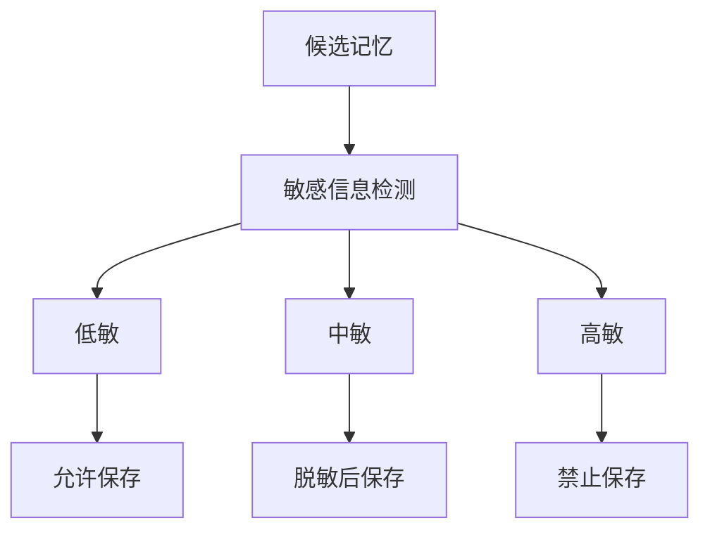

安全建议：

- 默认不保存敏感信息。
- 记忆存储加密。
- 云端同步使用账号权限隔离。
- 支持导出和删除。
- 记录记忆来源。
- 用户可查看和编辑记忆。
- 企业场景需要审计和合规策略。

## 二十、换电脑的实战方案一：Markdown 记忆加 Git

这是程序员个人最容易落地的方案。

### 1. 建立私有记忆仓库

```bash
git init llm-memory
```

目录结构：

```text
llm-memory
├── global
│   ├── MEMORY.md
│   └── user_preferences.md
├── workspaces
│   └── vue_01
│       ├── MEMORY.md
│       └── feedback_mermaid.md
└── references
    └── dashboards.md
```

### 2. 每条记忆独立成文件

好处是方便人工审查，也方便合并冲突。

### 3. 每台电脑同步仓库

```bash
git clone git@example.com:me/llm-memory.git
```

### 4. LLM 客户端启动时读取索引

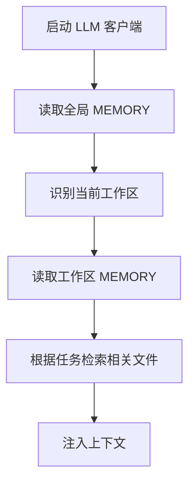

### 5. 更新后提交同步

```bash
git add .
git commit -m "Update LLM memory"
git push
```

这种方案简单可靠，缺点是需要自己维护同步习惯。可以配合定时任务或客户端自动提交。

## 二十一、换电脑的实战方案二：SQLite 加向量索引

如果想要本地优先、同时支持复杂检索，可以使用 SQLite 保存结构化记忆，再加一个向量索引。

架构：

```mermaid
flowchart TD
    A[LLM 客户端] --> B[SQLite 记忆库]
    B --> C[结构化查询]
    B --> D[向量索引]
    D --> E[语义召回]
    B --> F[同步目录或云端备份]
```

优点：

- 查询方便。
- 结构化字段完整。
- 可以本地加密。
- 可以同步一个数据库文件。

缺点：

- 并发写入和冲突处理比文件复杂。
- 人工查看不如 Markdown 直观。
- 需要额外开发检索逻辑。

## 二十二、换电脑的实战方案三：云端 Memory API

产品化系统一般使用云端 Memory API。所有客户端通过同一账号访问记忆服务。

```mermaid
flowchart TD
    A[电脑 A 客户端] --> B[Memory API]
    C[电脑 B 客户端] --> B
    D[手机客户端] --> B
    B --> E[鉴权服务]
    B --> F[记忆数据库]
    B --> G[向量检索服务]
    B --> H[审计日志]
```

API 示例：

```http
POST /memories
GET /memories/search?query=mermaid&scope=workspace:vue_01
PATCH /memories/{id}
DELETE /memories/{id}
```

适合团队或产品：

- 多端同步。
- 权限隔离。
- 审计合规。
- 统一加密。
- 支持组织级共享记忆。

## 二十三、团队共享记忆

个人记忆和团队记忆应该分开。个人记忆保存个人偏好，团队记忆保存项目共识、流程和共享资源。

```mermaid
flowchart TD
    A[请求上下文] --> B[个人记忆]
    A --> C[项目记忆]
    A --> D[团队知识库]
    B --> E[合并上下文]
    C --> E
    D --> E
    E --> F[LLM 回答]
```

团队共享记忆适合保存：

- 项目约定。
- 发布流程。
- 监控和告警入口。
- 重要架构决策。
- 常见故障处理流程。
- 需求和工单系统位置。

不适合保存：

- 个人隐私。
- 未确认的个人推断。
- 敏感凭证。
- 临时任务状态。

团队记忆最好有所有者、更新时间和审查机制。

## 二十四、长期任务状态和记忆的边界

很多人会把任务状态也塞进长期记忆，但这需要谨慎。任务状态变化快，容易过期。

例如：

- “今天正在调登录 bug”不适合作为长期记忆。
- “登录模块迁移到新认证中心，原因是旧系统不符合合规要求”适合作为项目记忆。

```mermaid
flowchart TD
    A[任务信息] --> B[是否短期进度]
    B --> C[是]
    C --> D[放入任务系统或当前计划]
    B --> E[不是]
    E --> F[是否代表长期背景]
    F --> G[是]
    G --> H[写入项目记忆]
    F --> I[不是]
    I --> J[不保存]
```

建议：

- 当前任务进度放在 todo、issue、plan、项目管理工具里。
- 长期背景、原因和约束才写入记忆。
- 任务完成后只保留对未来有帮助的经验和决策。

## 二十五、如何让 LLM 主动使用记忆

记忆系统存在不代表模型会正确使用。需要在系统提示词和运行流程中明确记忆使用策略。

策略示例：

```text
回答用户前，先判断当前请求是否可能受长期记忆影响。
如果涉及用户偏好、项目背景、外部资源、历史决策，请检索相关记忆。
使用记忆时，检查其适用范围、更新时间和置信度。
如果记忆与当前观察冲突，以当前事实为准，并考虑更新记忆。
```

```mermaid
flowchart TD
    A[用户请求] --> B[判断是否需要记忆]
    B --> C[需要]
    C --> D[检索记忆]
    D --> E[验证适用性]
    E --> F[使用记忆]
    B --> G[不需要]
    G --> H[直接处理]
```

比如用户只问“JavaScript 怎么写 for 循环”，一般不需要长期记忆；用户说“按我之前的文档规范再写一篇”，就应该检索偏好记忆。

## 二十六、如何避免记忆污染

记忆污染是指错误、过时、敏感、无关的信息进入长期记忆，导致未来回答变差。

常见污染来源：

- 模型把自己的猜测当事实保存。
- 把临时任务状态保存为长期背景。
- 把用户一次性要求保存为永久偏好。
- 把外部恶意文本当用户指令保存。
- 重复保存相同内容。
- 旧记忆没有过期机制。

```mermaid
flowchart TD
    A[候选记忆] --> B[来源检查]
    B --> C[价值检查]
    C --> D[敏感检查]
    D --> E[重复检查]
    E --> F[冲突检查]
    F --> G[保存]
```

防护方法：

- 保存前区分“用户明确说的”和“模型推断的”。
- 保存前做重复和冲突检测。
- 外部网页、文档、邮件内容不能直接变成用户偏好。
- 对项目记忆设置更新时间和过期策略。
- 提供记忆管理界面，让用户能查看和删除。

## 二十七、长期记忆的用户体验设计

记忆系统如果太打扰用户，会让人烦；如果完全黑盒，又会让人不信任。

比较好的体验是：

- 用户明确说“记住”时，系统简短确认。
- 隐式记忆不频繁打断，必要时合并确认。
- 最终回答中不要总是强调“根据记忆”。
- 当记忆影响重要决策时，说明使用了哪条关键记忆。
- 用户可以查看、编辑、删除记忆。
- 用户可以临时要求“不使用记忆”。

```mermaid
flowchart TD
    A[记忆交互] --> B[显式保存]
    A --> C[隐式候选]
    A --> D[查看管理]
    A --> E[删除遗忘]
    A --> F[临时禁用]
```

示例交互：

```text
用户：以后写文档都用中文。
系统：已记住：文档类任务优先使用中文。
```

隐式场景可以减少打扰：

```text
系统内部：用户连续多次要求 Mermaid 兼容旧版本，生成低置信度候选。下次类似任务中优先遵守，或在设置页提示用户确认。
```

## 二十八、长期记忆和 RAG 的区别

长期记忆和 RAG 很像，但关注点不同。

| 能力 | 长期记忆 | RAG |
| --- | --- | --- |
| 主要对象 | 用户、项目、偏好、历史决策 | 文档、知识库、代码、资料 |
| 更新来源 | 对话和行为 | 文档导入和数据源同步 |
| 粒度 | 结构化事实和偏好 | 文档片段 |
| 作用 | 个性化和连续性 | 知识增强 |
| 风险 | 隐私和过期 | 召回错误和资料陈旧 |

```mermaid
flowchart TD
    A[用户请求] --> B[长期记忆]
    A --> C[RAG 文档检索]
    B --> D[个性化上下文]
    C --> E[知识资料上下文]
    D --> F[LLM 回答]
    E --> F
```

最好两者配合：长期记忆告诉模型“这个用户和项目有什么背景”，RAG 告诉模型“相关资料具体怎么说”。

## 二十九、长期记忆和知识图谱

当记忆中实体关系很多时，可以引入知识图谱。例如人、项目、服务、文档、工单、仓库之间的关系。

```mermaid
flowchart TD
    A[用户] --> B[负责项目]
    B --> C[依赖服务]
    C --> D[监控看板]
    B --> E[代码仓库]
    B --> F[需求文档]
```

知识图谱适合回答：

- 这个项目依赖哪些服务。
- 某个监控看板对应哪个模块。
- 谁负责某个系统。
- 某个决策影响哪些组件。

图谱记忆的难点是维护成本高，适合团队级系统，不一定适合个人轻量使用。

## 三十、长期记忆的评测

长期记忆系统需要评测，否则很难知道它是否真的有帮助。

```mermaid
flowchart TD
    A[构建评测任务] --> B[准备历史记忆]
    B --> C[发起新请求]
    C --> D[观察是否召回正确记忆]
    D --> E[判断回答是否更好]
    E --> F[记录失败原因]
```

评测指标：

- 记忆召回准确率。
- 记忆误召回率。
- 过期记忆使用率。
- 用户偏好遵守率。
- 冲突处理正确率。
- 敏感信息保存拦截率。
- 换设备恢复成功率。
- 用户删除记忆后的遗忘成功率。

示例评测：

```json
{
  "memory": "用户生成 Markdown 文档时要求 Mermaid 不使用双向连线。",
  "request": "帮我写一篇带流程图的技术文章。",
  "expected": "生成 Mermaid 时使用 flowchart 和单向连线"
}
```

## 三十一、实现一个最小长期记忆系统

下面是一个最小可用版本的思路。

### 1. 保存记忆

```ts
type Memory = {
  id: string;
  type: 'user' | 'preference' | 'project' | 'reference';
  title: string;
  content: string;
  scope: string;
  source: 'explicit' | 'inferred';
  confidence: number;
  updatedAt: string;
};

const memories: Memory[] = [];

function saveMemory(memory: Memory) {
  memories.push(memory);
}
```

### 2. 检索记忆

```ts
function searchMemories(query: string, scope: string) {
  return memories.filter(memory => {
    return memory.scope === scope && memory.content.includes(query);
  });
}
```

### 3. 注入上下文

```ts
function buildPrompt(userInput: string, relatedMemories: Memory[]) {
  const memoryText = relatedMemories.map(memory => {
    return `[${memory.type}] ${memory.title}: ${memory.content}`;
  }).join('\n');

  return `
相关长期记忆：
${memoryText}

用户请求：
${userInput}
`;
}
```

最小系统可以先用关键词检索，后续再增加 embedding、权限、同步和 UI。

```mermaid
flowchart TD
    A[保存记忆数组] --> B[根据关键词检索]
    B --> C[拼接相关记忆]
    C --> D[构建 Prompt]
    D --> E[调用 LLM]
```

## 三十二、生产级长期记忆系统架构

生产级系统需要考虑多租户、权限、审计、同步、检索质量和数据治理。

```mermaid
flowchart TD
    A[客户端] --> B[Memory API]
    B --> C[鉴权和租户隔离]
    C --> D[记忆写入服务]
    C --> E[记忆检索服务]
    D --> F[敏感信息检测]
    F --> G[结构化数据库]
    G --> H[向量索引]
    E --> I[过滤和重排]
    I --> J[上下文注入]
    B --> K[审计日志]
```

关键模块：

- 记忆提取器。
- 敏感信息检测器。
- 结构化存储。
- 向量索引。
- 检索重排器。
- 冲突合并器。
- 用户管理界面。
- 删除和导出能力。
- 审计日志。

## 三十三、记忆系统和多 Agent 协作

如果系统里有多个 Agent，例如代码 Agent、测试 Agent、文档 Agent，它们可以共享部分记忆，也可以拥有各自的专业记忆。

```mermaid
flowchart TD
    A[共享记忆库] --> B[代码 Agent]
    A --> C[测试 Agent]
    A --> D[文档 Agent]
    B --> E[代码偏好和项目结构]
    C --> F[测试策略和稳定性记录]
    D --> G[文档格式和术语偏好]
```

需要注意：

- 共享记忆必须有范围和权限。
- 专业 Agent 不应随意覆盖全局偏好。
- 冲突时需要按来源和优先级处理。
- 多 Agent 写入记忆时要做去重和审查。

## 三十四、常见错误做法

### 1. 保存所有聊天记录当记忆

这样会导致检索噪声大、成本高、隐私风险高。聊天记录适合归档，不适合作为主记忆。

### 2. 不区分事实和推断

模型推断出的“用户可能喜欢某种方式”不能直接当作高置信事实。

### 3. 没有过期机制

项目状态变化很快，旧记忆如果一直生效，会误导模型。

### 4. 记忆不可见不可删

用户不知道系统记了什么，就很难信任它。必须提供查看和删除能力。

### 5. 把敏感信息写入记忆

Token、密码、Cookie、私钥不应该进入长期记忆。即使用户误发，也应该过滤。

```mermaid
flowchart TD
    A[记忆系统误区] --> B[保存过多]
    A --> C[不区分来源]
    A --> D[没有过期]
    A --> E[不可管理]
    A --> F[保存敏感信息]
```

## 三十五、最佳实践清单

构建长期记忆系统时，可以参考以下清单：

- 只保存未来有价值的信息。
- 每条记忆都有类型、范围、来源、时间和置信度。
- 用户明确要求保存时优先保存。
- 模型推断出的记忆降低置信度或请求确认。
- 敏感信息默认不保存。
- 当前事实优先于历史记忆。
- 记忆检索要按工作区和任务过滤。
- 召回记忆要控制数量，避免污染上下文。
- 支持查看、编辑、删除和导出。
- 支持跨设备同步。
- 定期清理过期和重复记忆。
- 对记忆系统做评测。

```mermaid
flowchart TD
    A[长期记忆最佳实践] --> B[少而准]
    A --> C[结构化]
    A --> D[可同步]
    A --> E[可管理]
    A --> F[可遗忘]
    A --> G[可评测]
```

## 三十六、总结

让 LLM 换电脑后依旧记得之前，关键不是让模型本身永久改变，而是在模型外部建立一套长期记忆系统。它应该能从对话中提取有价值的信息，结构化保存，跨设备同步，在新任务中按需检索，并在过期、冲突、敏感时正确处理。

个人使用可以从最简单的 Markdown 文件加 Git 同步开始：每条记忆独立成文件，索引文件负责导航，换电脑后拉取同一个私有仓库即可恢复。产品化系统则更适合使用云端数据库、向量索引、账号体系、权限隔离和审计日志。

真正好的长期记忆不是“什么都记”，而是“记该记的、忘该忘的、用的时候能找到、过期时会更新、用户随时能管理”。这样 LLM 才能从一次性对话工具，逐渐变成跨设备、跨会话、理解用户和项目背景的长期协作伙伴。
